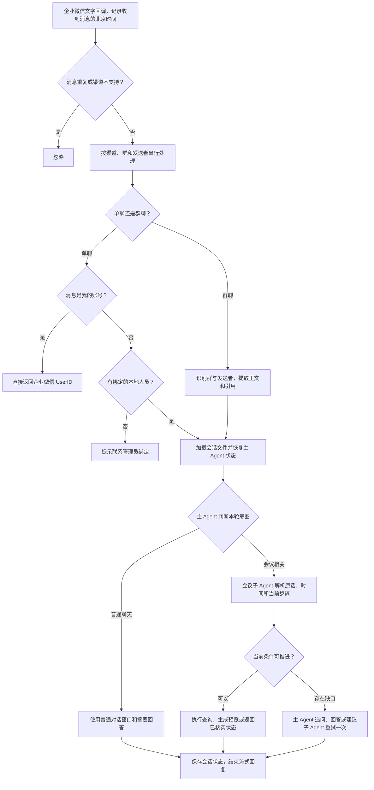
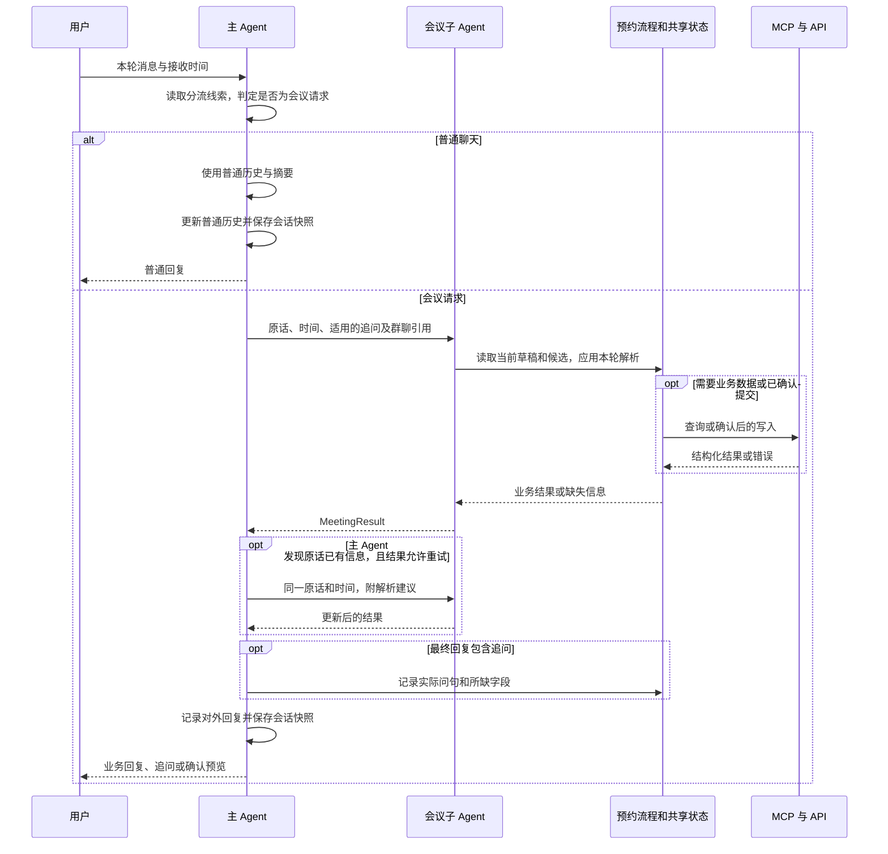
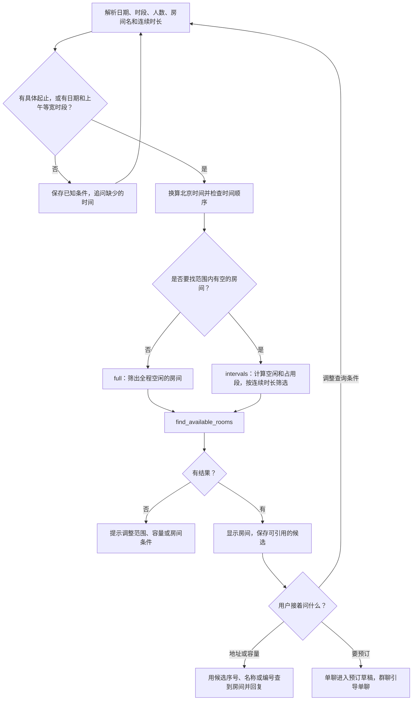
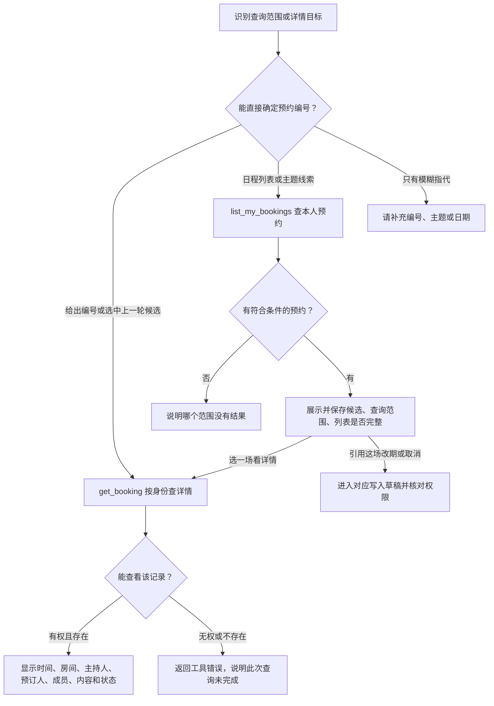
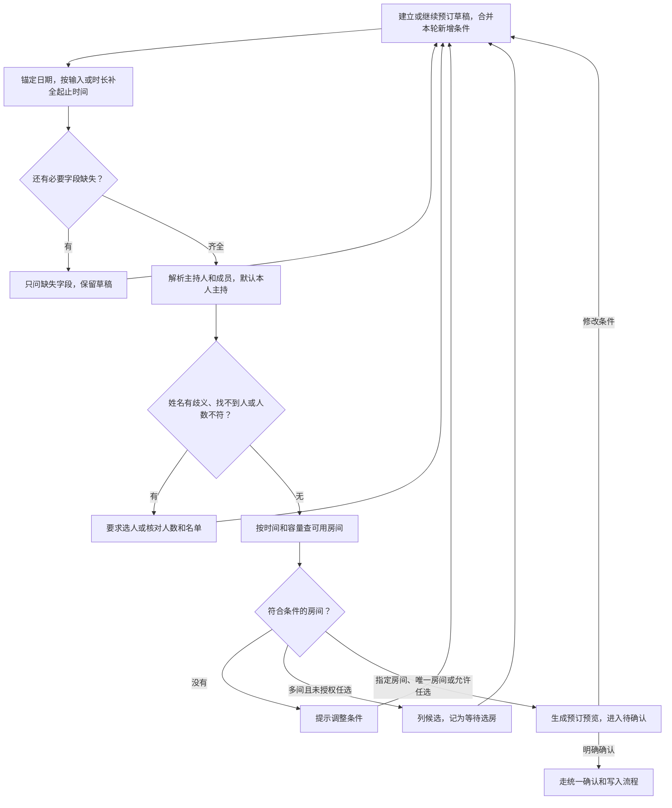
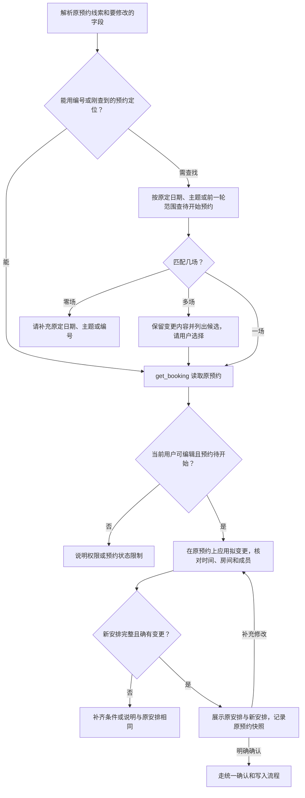
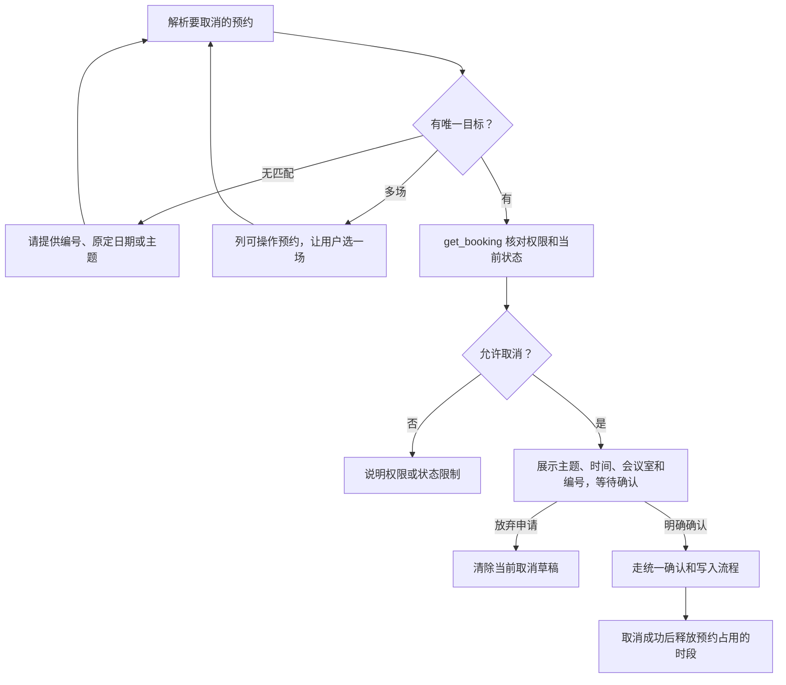
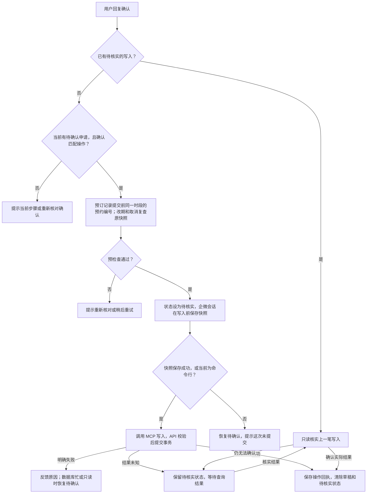
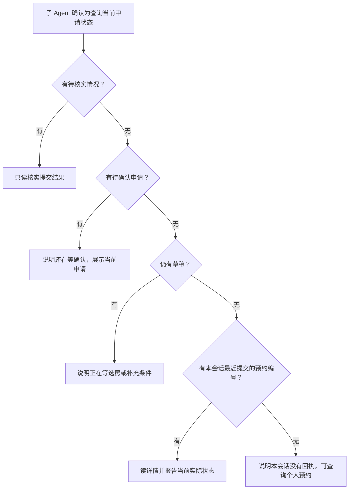
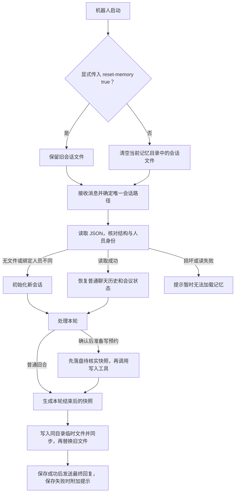

# 企业微信会议室助手｜对话流程与记忆设计

## 1. 单聊和群聊能做什么

### 单聊

- 发「我的账号」可查看企业微信 UserID。其他对话先将当前发送者映射到 SQLite 中绑定的人员。未绑定时，机器人提示联系管理员。
- 支持普通聊天、能力介绍、查空闲会议室和候选房间详情、查询本人预约、查看预约详情。
- 支持新建预订、改日期或时间、换房、修改主题或内容、调整其他与会人员和取消预约。用户核对具体申请并明确确认后，才会调用写入工具。
- 支持代订。发起人记为预订人，指定人员可作为主持人。本人创建、主持或参加的会议都能查看，修改和取消只允许预订人或主持人办理。
- 支持补充条件、选候选、继续或放弃草稿、查询是否提交，以及在提交结果未知时核实。

### 群聊

- 在群里 @ 机器人发文字，可以闲聊、问能力、查空房、问候选房间的地址和容量。可引用群消息提供线索，也可在机器人追问后再次 @ 它补充。
- 群聊查房无需绑定人员。群聊的会议工具只允许调用 `find_available_rooms`。个人预约、人员查询和预约写入走单聊。空房结果里的占用只显示起止时段。
- 同一用户在不同群里的上下文各自独立。不同群成员 @ 机器人时也各自续接自己的对话。其他成员可以看到群里已发送的回复。

## 2. 从一条消息到回复

企业微信入口在 [wecom/main.py](main.py)。主 Agent 和会议子 Agent 默认使用同一个本地 Qwen 模型。主 Agent 负责分流、普通聊天和对用户的措辞，会议子 Agent 负责解析具体业务意图。流程代码更新草稿、检查规则并调用工具。MCP 转发到 FastAPI，API 和 SQLite 执行实际预约查询及写入。普通聊天可在会议服务尚未连接时处理。



### 分流、追问和事实校验

- 分流输入包括本轮时间、当前业务步骤、是否有待确认申请、实际发出的上一条会议追问，以及有限的普通聊天线索。诸如「早上十点」「第二间」通常会结合正在等待的字段解读。「预定了吗」会交给子 Agent 判断是否在问提交状态，路由标记本身不会直接返回状态。
- 子 Agent 使用最近三轮会议对话、草稿和候选。缺信息时返回原因、字段和建议。主 Agent 可以直接追问，也可以带解析建议重试一次。重试用于理解用户已说过的信息。明确提交仍须经过确认流程。
- 模型可以调整措辞。流程保留候选、日期、编号和提交结果等业务事实。对已知日期追问时，如果模型写出了与草稿矛盾的 ISO 日期，使用流程原本生成的追问。
- 模型输出异常、服务断开和工具失败会给出对应提示。流程使用结构化字段和校验，部分常用表达、相对日、编号、确认和引用仍有程序分支。

### 主 Agent 和会议子 Agent 怎样交流

两层 Agent 由同一个 Python 进程协调。默认共用本地 Qwen 模型，分别使用分流、业务解析、协调和结果呈现的提示词。Agent 之间通过函数参数、结构化结果和共享的会议状态交接。MCP 连接只用于业务工具调用。

1. **主 Agent 先分流。** `route()` 把本轮原话、接收时间、上一轮的话题类别、会议步骤、实际发出的上一条追问及少量状态标记传给模型。输出包括 `route`、`new_request` 和 `booking_status`。全新的查询或操作可标记为新请求，本轮就不会被当作回答旧追问。分流标记为查询提交状态时，也会由子 Agent 再分析原话。
2. **主 Agent 将原话交给子 Agent。** `MeetingAgent.handle()` 接收用户原话、本轮时间和适用的上一条追问。群聊引用作为单独的参考字段交接。子 Agent 补入最近三轮会议对话及 `workflow.context()`，由模型生成业务意图、本轮新增字段或选择。确定用户是在补主题、补时间或选原预约时，可以使用只包含相关字段的解析结构。
3. **子 Agent 推进业务，并把结果交还主 Agent。** 子 Agent 把解析结果交给预约流程，流程合并草稿、校验条件，并按需调用 MCP。返回的 `MeetingResult` 含业务回复 `text`、可选的 `issue`、结果保护标记 `protected` 和状态查询标记 `read_status`。如果卡住，`issue` 会带原因、所缺字段和建议，例如 `booking_fields_missing`、`starts_at` 和 `ends_at`。主 Agent 收到的是这些业务信息和当前状态，可以据此向用户解释或继续推进。
4. **主 Agent 决定怎样回复。** 信息确实不足时用 `ask` 生成追问，并记录实际发出的问句及字段。如果信息已经在原话或草稿里，可用 `retry` 将简短建议与同一条原话交还子 Agent，最多一次。已有业务结果时用 `answer` 或直接呈现。选房和多场待选的预约保留原候选列表；已核实的提交状态可直接返回。重试建议不能代替用户确认。
5. **保存最终回复与已更新的状态。** 主 Agent 将用户原话和最终给用户看的会议回复写入会议历史。子 Agent 的中间答复和重试建议留在本轮处理里。企业微信入口随后保存快照，下一条消息就能从最新草稿和实际追问继续。



例如用户说「明天订间房，主题是项目总结」，子 Agent 将日期和主题写入草稿，并报告缺开始和结束时刻。主 Agent 问「几点开始、几点结束」，把实际问句和这两个字段一起保存。下一轮用户只回「十点到十二点」，主 Agent 结合该追问判为补充，子 Agent 以草稿日期生成绝对时间并继续查房。如果用户此时转而问「你能做什么」，主 Agent 可以直接闲聊，之后仍可接着办理原草稿。

## 3. 查空闲会议室与查看房间信息

单聊和群聊都可以查询。支持指定起止时刻、宽松时段、最少座位数、房间名称，以及宽松范围内所需的最短连续空闲时长。



宽时段默认是上午 08:00–12:00、下午 13:00–18:00、晚上 18:00–22:00，可通过 `MEETING_MORNING_HOURS`、`MEETING_AFTERNOON_HOURS`、`MEETING_EVENING_HOURS` 设置。候选一般最多展示五条。有更多候选时提示缩小范围。查房用的宽范围可以带入预订作为搜索范围，实际预约的起止时间须由用户给出，或者由用户明确授权在该范围内按时长任选。

## 4. 查询个人预约和查看详情

在单聊查询当前账号创建、主持或参加的预约。无筛选的「查我的预约」默认查待开始的会议。指定某天时，范围为北京时间当天零点至次日零点，匹配与范围相交的预约。也可以按时段、房间、主题线索或状态筛选。



## 5. 新建预订

在单聊发起预订，需要主题、未来的起止时刻和可用房间。默认本人主持。可指定其他主持人、其他与会人员、容量和会议内容。容量计算包含主持人，其他成员名单须去除重复及主持人。



例如 11 月 15 日说「明天订间房，主题是项目总结」，草稿先保存 11 月 16 日。过了午夜才补「10 点到 12 点」，时段仍沿用草稿日期。候选已展示时，回复「二楼讨论室」可识别为选房。回复「预定了吗」则查询流程状态。

## 6. 改期、换房和编辑会议内容

在单聊发起改期、换房、修改主题或内容、增删或整批替换其他与会人员，都走 `reschedule_booking`，提交时更新同一申请编号。用户可清空内容或其他成员名单。主持人字段当前不在修改范围。



- 原定日期用来定位预约，新日期用来生成变更。例如先查到 11 月 15 日 14:00–15:00 的会议，再说「把这个会议改成明天同样时间点」，会引用原预约，将原起止时间整体移到 11 月 16 日。
- 仅换日期和时间时保持原房间；同房新时段的最终冲突由 API 在提交时检查。显式换房或授权任选时，流程可先查可用房间并等待选房。编辑内容、主题或成员可保留原起止时间和房间。
- 提交前再读一次原预约。如果它在预览后发生改变，要重新核对。未通过 API 权限、状态、时间冲突或容量校验时，原预约保持原状。

## 7. 取消预约

在单聊发起取消。用户须为预约的预订人或主持人，且流程处理的是待开始的预约。申请预览将展示要取消的会议。



## 8. 统一确认、提交和核实



- **确认与放弃**：「确认」「确认改期」等会对应已展示的申请。表达附带修改条件，或者确认的操作和待确认申请不一致时，需要继续核对。「继续申请」可回到草稿。「放弃申请」作用于当前草稿。查询与写入草稿分别保存，插入新的业务查询后可能需要「继续申请」重新生成确认预览。
- **写入接口**：新建用 `create_booking`，编辑或改期用 `reschedule_booking`，取消用 `cancel_booking`。预览只保存申请，真正的写入只出现在确认后的分支。
- **核实新建**：查申请时段，排除确认前已存在的预约，匹配预订人、房间、主题、起止和主持人，再读详情核对内容与成员。**核实修改或取消**：按原编号读取，检查修改字段是否已生效，或状态是否为「取消」。如果仍无法确认，可稍后再核实。人工核对后，「结束核实」可以解除当前会话的待核实状态。

### 「预定了吗」的处理



提交状态根据本会话的结构化状态和工具结果回答。单独询问状态不会触发预约写入。

## 9. 记忆管理设计

### 按渠道和身份定位

企业微信默认使用 `data/wecom_memory/`。由于启动时默认清空，只有以保留模式启动的机器人才能跨重启续接以前的草稿。运行期间每轮都通过文件恢复。命令行 Agent 的状态在本地进程中，退出后结束该会话。预约和账号绑定由 SQLite 管理。

```text
data/wecom_memory/
  single/
    id-<用户ID可读部分>-<哈希>.txt
  groups/
    id-<群ID可读部分>-<哈希>/
      id-<用户ID可读部分>-<哈希>.txt
```

文件名对原 ID 做安全字符替换和长度限制，再拼接 SHA-256 区分同名或大小写不同的 ID。文件是 UTF-8 JSON。顶层 `person_id` 用来核对当前账号绑定，群聊值为空；`agent` 是会话快照。单聊账号重新绑定到其他人员后，原快照不会加载到新身份。默认目录由 Git 忽略。

### 保存内容及使用方式

- **主 Agent 管普通历史。** `chat_history` 记录最近 4 轮普通对话，`chat_summary` 保存较早对话的滚动摘要。第 5 轮起尝试把移出的对话合并到摘要，摘要最多 800 字符。待摘要队列 `unsummarized_chat` 最多 4 轮，摘要请求抛出错误时保留以便重试。`last_route` 标记上一轮的话题。普通聊天回复使用本轮消息、普通历史及摘要，会议草稿继续保留在会话中。分流模型会另外读取会议待办的少量标记和上一条追问。
- **会议子 Agent 管近期会议历史。** `meeting_history` 保存最近 3 轮用户原话和主 Agent 最终回复，每轮带收到时的北京时间。子 Agent 日常解析读取这三轮、当前追问和业务状态，普通聊天摘要留在主 Agent。最近会议历史按轮覆盖，无单独的滚动摘要。近期对话里，用户原话每条最多 600 字符，助手回复每条最多 1000 字符。较老的双元素历史记录仍可加载，时间保持未知。模型推理文本不会进入历史。
- **双方共享一份会议业务状态。** `draft` 保存写入草稿，`query` 保存查询条件和候选，`booking_search` 保存预约查询范围、候选和结果是否完整。`pending` 保存待确认申请，`uncertain` 保存待核实的写入。最近查看及提交的编号帮助解析「刚才那场」。子 Agent 的预约流程更新这些字段，主 Agent 读取其中的步骤用于分流，也会在协调追问时读取草稿和候选。主 Agent 负责写入实际发给用户的 `question`，子 Agent 下一轮用它判断用户正在回答什么。确认阶段还可保存原预约快照或提交前同一时段的编号，用于复查。
- **统一从同一份快照恢复。** 企业微信入口加载 `AgentMemory`，主 Agent 立即恢复普通历史和上轮话题，并能用快照中的会议状态做分流。首次进入会议流程时，再将已保存的会议历史和状态恢复到子 Agent。回合结束汇总到同一个会话文件。近期聊天滚出历史窗口时，进行中的会议草稿仍随结构化快照保存。
- **时间锚点**：`at` 使用带 `+08:00` 的 ISO 8601。历史里的「明天」按该历史消息的日期理解，本轮的相对表达按本轮接收时间理解。已经解析的申请日期和绝对起止保留在草稿中。补时刻沿用原日期，明确改日期时才更新草稿。

### 读取、保存、恢复和清空



- 裸启动 `python -X utf8 -m wecom.main` 默认清空。显式 `--reset-memory false` 同样清空。要恢复以前的会话，使用 `--reset-memory true`。可用 `--memory-dir` 选择目录。清空按机器人生成的文件名和会话子目录匹配，和数据库保存的预约、绑定分开。
- 在同一个机器人进程内，以渠道、群和发送者为键串行处理，同一会话不会在两条消息间交叉覆盖。机器人缓存最近 2048 个消息 ID 用于回调去重。当前没有跨进程会话锁或跨重启消息 ID 去重。
- 默认清空也会删除待核实记录。如果服务在写入期间中断、需要用会话记录继续核实，重启时传 `--reset-memory true`。已实际提交的业务记录仍可从个人预约查询。

## 10. 代码入口和调试

- [企业微信入口与账号绑定](main.py)处理长连接回调、身份映射、流式回复及文件读写时机。
- [会话文件读写](memory.py)定义文件键、加载检查、原子替换和清空范围。
- [主 Agent 和会议子 Agent](../agent/main.py)定义结构化解析、会话恢复、话题分流、业务回复协调和 MCP 调用。
- [会议流程及草稿状态](../agent/workflow.py)管理候选、待确认申请、写入和核实。
- [MCP 工具](../mcp_server/README.md)和 [FastAPI 接口](../api/README.md)说明工具参数、身份传递、业务约束及响应。
- Mermaid 流程图可在支持 Mermaid 的 Markdown 阅读器中查看。代码联调可通过命令行的 `--trace` 查看分流、意图和工具调用结果。企业微信实际试用时可按 [启动说明](README.md)分别检查单聊身份、群内续问和重启保留模式。
